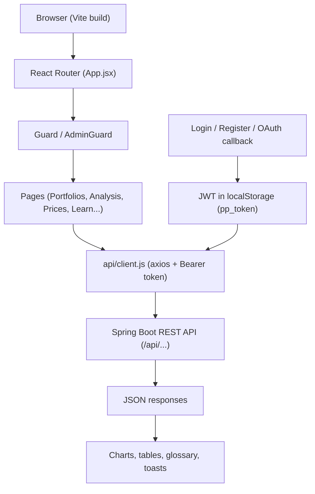
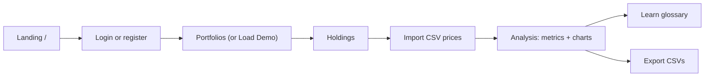

<div align="center">

# PortfolioPilot — Frontend

**Quantitative portfolio risk, return, and diversification analysis — web client.**


**[Live application](https://portfolio-pilot-frontend-pi.vercel.app)** ·
[Backend repo](https://github.com/shb09/portfolio-pilot-backend) ·
[Monorepo](https://github.com/shb09/portfolio-pilot)

*Live demo: open the app, register in seconds, and press **Load Interactive Demo** —
no real money or market data involved.*

</div>

**Quantitative Portfolio Risk, Return, and Diversification Analysis Platform (web client).**

PortfolioPilot helps investors understand portfolios they already hold: create named
portfolios, record holdings, import historical prices from validated CSV files, and get
backend-computed valuation, risk, and benchmark analytics with interactive charts and
plain-English explanations. It is a **historical analysis application, not a trading
platform** — it executes no trades, places no broker orders, and never predicts returns.

> Split from the complete project history
> ([shb09/portfolio-pilot](https://github.com/shb09/portfolio-pilot)).
> API service: [shb09/portfolio-pilot-backend](https://github.com/shb09/portfolio-pilot-backend).
> No server secrets belong in this repository.

## Contents

- [Live application and source links](#live-application-and-source-links)
- [Feature overview](#feature-overview)
- [Screenshots](#screenshots)
- [Architecture](#architecture)
- [User flow](#user-flow)
- [Folder structure](#folder-structure)
- [Installation and local development](#installation-and-local-development)
- [Environment variables](#environment-variables)
- [API integration](#api-integration)
- [Deployment](#deployment)
- [Testing, limitations, and future enhancements](#testing-limitations-and-future-enhancements)
- [Related repositories](#related-repositories)

## Live application and source links

| | |
|---|---|
| **Live frontend (user-facing app)** | [https://portfolio-pilot-frontend-pi.vercel.app](https://portfolio-pilot-frontend-pi.vercel.app) |
| **Backend API service** | [https://portfolio-pilot-api-0e01.onrender.com](https://portfolio-pilot-api-0e01.onrender.com) |
| **Frontend repository (this repo)** | [https://github.com/shb09/portfolio-pilot-frontend](https://github.com/shb09/portfolio-pilot-frontend) |
| **Backend repository** | [https://github.com/shb09/portfolio-pilot-backend](https://github.com/shb09/portfolio-pilot-backend) |
| **Monorepo (full history)** | [https://github.com/shb09/portfolio-pilot](https://github.com/shb09/portfolio-pilot) |

## Feature overview

| Capability | Where | Notes |
|---|---|---|
| Password + Google sign-in | `/login`, `/register` | Google button appears only when the backend enables it |
| Portfolios + benchmarks | `/portfolios` | CRUD, benchmark symbol, detail snapshots |
| Holdings | `/portfolios/:id` | Symbol, category, quantity; duplicates rejected |
| CSV price import | `/prices` | Row-level errors, duplicate-safe re-imports |
| Risk/return analytics | `/analysis` | Backend-computed cards with reasons, never NaN |
| Performance charts | `/analysis` | Rebased performance + drawdown, date ranges, CSV export |
| Glossary + tour | `/learn`, `/walkthrough` | One definition source for page and inline help |
| One-click demo | `/portfolios` | Simulated data, idempotent resume, guided steps |

What each feature gives you (all call the real backend APIs — nothing is mocked):

- **Authentication** (`src/pages/Login.jsx`, `Register.jsx`, `auth/AuthContext.jsx`) —
  username-or-email + password login, registration with immediate JWT session, email
  verification / forgot / reset flows, and **Continue with Google** (rendered only when
  the backend reports `googleEnabled: true` from `GET /api/auth/oauth/status`).
- **Investment portfolios** (`PortfoliosPage.jsx`) — create/edit/delete named portfolios
  with an optional benchmark symbol; per-portfolio detail with snapshot cards and
  allocation bars (`HoldingsPage.jsx`).
- **Holdings and quantities** — per-portfolio positions (`symbol`, category, positive
  quantity); duplicate symbols are rejected by the API with a clear message.
- **CSV price import** (`PricesPage.jsx`) — uploads `date,symbol,close` files to
  `POST /api/prices/import`; per-row errors with line numbers, duplicates skipped, live
  symbol list and latest-rows preview.
- **Valuation, allocation, returns, volatility, Sharpe, drawdown, HHI, benchmark** —
  every figure is backend-computed (`AnalysisPage.jsx` renders them with units, periods,
  and reasons instead of fabricating missing values).
- **Interactive charts** — portfolio-vs-benchmark performance (rebased to 100) and
  drawdown views over the backend value series, with hover/touch/keyboard inspection
  showing real dates and values.
- **Date-range filtering** — metrics, chart, and benchmark comparison recompute on the
  backend for the selected window (`?start=&end=`).
- **Holdings search/sort, CSV exports** — filterable/sortable positions table; one-click
  downloads of the analysis series and holdings as CSV.
- **Learn section and glossary** (`GlossaryPage.jsx`, `data/glossary.js`, `FinancialTermHelp.jsx`) —
  searchable definitions sharing one data module with every inline help icon, so
  explanations cannot contradict each other; includes formulas, assumptions, and caveats.
- **Interactive demo** (`DemoSetup.jsx`, `WalkthroughPage.jsx`, `Tour.jsx`) — one-click
  `Load Interactive Demo` builds a sample portfolio through the real APIs (idempotent:
  reruns resume, never duplicate), plus a 6-step guided walkthrough gated on real data
  and a skippable first-visit tour. **All bundled demo prices are simulated historical
  data, not live market quotes** — disclosed in-app wherever demo data appears.
- **Responsive UI + states** — mobile-validated layouts, skeleton loaders, empty states
  with next actions, inline field errors, toasts; Paper (light) and Carbon (dark) themes
  persisted via `pp_theme`.

## Screenshots

No screenshots are currently committed to this repository. To add them:

1. Capture the live app (dashboard, portfolios, analysis chart, benchmark, CSV import, login).
2. Save PNGs under `docs/screenshots/` (create the folder; keep each image < 500 KB).
3. Reference them here with relative paths and descriptive alt text, e.g.
   ``.

Do not commit stock imagery or invented paths — screenshots must show the real product.

## Architecture

- **Entry point:** `src/main.jsx` mounts `App.jsx` (router) inside auth and theme providers.
- **Routing:** `react-router-dom` v7 in `src/App.jsx`. Public: `/`, `/login`, `/register`,
  `/verify`, `/forgot`, `/reset`, `/oauth/callback`, `/portfolio/:username`. Guarded
  (`Guard` → `/login` when unauthenticated): `/portfolios`, `/portfolios/:id`, `/prices`,
  `/analysis`, `/learn`, `/walkthrough`, `/settings`, plus legacy career pages;
  `/dashboard`, `/preview`, `/analytics` redirect into the financial workspace.
  `/admin` is additionally role-gated (`AdminGuard`).
- **Pages vs components:** `src/pages/` owns one route each; `src/components/` holds the
  reusable surface (`Layout`, `CrudPage`, `FinancialTermHelp`, `DemoSetup`, `Tour`,
  `Stat`, `Toast`, motion/effect utilities).
- **API client:** `src/api/client.js` (axios). Base URL is the bare backend origin from
  `VITE_API_URL` plus `/api` in production, same-origin `/api` in dev (Vite proxy to
  `localhost:8080`); JWT from `localStorage pp_token` is attached as
  `Authorization: Bearer`. Errors surface the backend's `error`/`details` message.
- **Auth state:** `src/auth/AuthContext.jsx` revalidates the session via `GET /auth/me`
  on load; user/token persist as `pp_user`/`pp_token`.
- **Charts:** dependency-free SVG (`AnalysisPage.jsx`) drawn from the backend `series`
  array — no charting library in `package.json`.
- **Styling:** Tailwind CSS v4 + `src/index.css` design tokens; Lucide icons;
  Framer Motion for menus/dialogs/toasts only (no animated content).



## User flow

1. Open `/` (landing) and choose login or registration.
2. Authenticate (password, or Google when the backend enables it).
3. Land on **Overview → Investment Portfolios** (`/portfolios`).
4. Create a portfolio (optional benchmark symbol) or press **Load Interactive Demo**.
5. Open the portfolio and add holdings (symbol, category, quantity).
6. On **Prices**, import a `date,symbol,close` CSV and check the import report.
7. On **Analysis**, pick the portfolio; optionally set a date range or benchmark.
8. Read metric cards, hover the performance/drawdown chart, inspect holdings and allocation.
9. Export series/holdings CSVs as needed.
10. Open **Learn** for any unfamiliar term — definitions match the inline help exactly.



## Folder structure

```text
├── index.html                  # document shell, title/meta, favicon links, theme bootstrap
├── public/
│   ├── demo/                   # bundled SIMULATED price CSVs + demo manifest (not live data)
│   ├── favicon.* / apple-touch-icon.png
│   └── _redirects
├── src/
│   ├── main.jsx / App.jsx      # entry, router, guards, redirects
│   ├── api/client.js           # axios instance, base-URL logic, error helper
│   ├── auth/AuthContext.jsx    # session, login/register/logout, pp_token storage
│   ├── theme/ThemeContext.jsx  # paper/carbon themes (pp_theme)
│   ├── config/modules.js       # CRUD page configs (financial + legacy career modules)
│   ├── data/glossary.js        # single source for all financial explanations
│   ├── components/             # Layout, CrudPage, DemoSetup, FinancialTermHelp,
│   │                           # Tour, Stat, Toast, motion/effect utilities
│   ├── pages/                  # one route each (see Architecture)
│   └── index.css               # Tailwind v4 + design tokens + glass utilities
├── vite.config.js              # :5173 strictPort, /api + /portfolio dev proxy
└── docs/                       # PRD, API/design/architecture notes, demo-data guide,
                                # deployment, security, increments
```

## Installation and local development

Prerequisites: Node.js 20+, npm, and the backend running (see backend README).

```bash
git clone https://github.com/shb09/portfolio-pilot-frontend.git
cd portfolio-pilot-frontend
npm install
npm run dev      # http://localhost:5173 (strictPort: fails fast if busy)
npm run build    # production bundle to dist/
npm run lint     # oxlint, 0 errors expected
npm run preview  # serve the production bundle locally
```

Notes:

- There is **no frontend test script** (`package.json` ships `dev/build/lint/preview` only).
- `npm run dev` uses `--port 5173 --strictPort` semantics from `vite.config.js`; if the
  port is taken, stop the other process instead of hopping ports.
- Dev API calls are same-origin (`/api/...`) and proxied to `http://localhost:8080` —
  no CORS setup needed locally and no env file required.
- Common issue — blank data or auth errors in dev: the backend on `:8080` is not running.

## Environment variables

Vite embeds these into the production bundle at **build time** — they are public to
every visitor and must never contain secrets.

| Variable | Purpose | Required | Example |
|---|---|---|---|
| `VITE_API_URL` | Bare backend origin (no `/api` suffix; client appends it). Empty in dev (uses proxy). | Yes, in production builds | `https://portfolio-pilot-api-0e01.onrender.com` |
| `VITE_PUBLIC_URL` | Optional override for public `/portfolio/...` links. | No | `https://portfolio-pilot-frontend-pi.vercel.app` |

After changing variables, rebuild and redeploy — a running deployment keeps the old values.

## API integration

- Transport: JSON over HTTPS via axios; `Authorization: Bearer <JWT>` on authenticated
  calls; public routes (`/portfolio/:username`, analytics events) carry no token.
- Base URL logic (`src/api/client.js`): `VITE_API_URL + "/api"` in production,
  same-origin `/api` in development.
- Errors: the helper returns the backend's `error`/`details` string when present, so
  validation messages (duplicate symbol, bad CSV row, unknown portfolio) reach the user.
- Operations used (authoritative definitions live in the backend README): auth
  register/login/verify/resend/forgot/reset/oauth-status/oauth-exchange/me; portfolio
  CRUD; holdings CRUD; price import/symbols/recent; windowed analysis; admin stats/users.
- OAuth button visibility: `GET /api/auth/oauth/status` → `{ "googleEnabled": true }`;
  the login page links to the backend authorize URL and completes at `/oauth/callback`.

## Deployment

- Hosting: **Vercel**, auto-deploying the `main` branch of this repository.
- Live URL: [https://portfolio-pilot-frontend-pi.vercel.app](https://portfolio-pilot-frontend-pi.vercel.app).
- API: [https://portfolio-pilot-api-0e01.onrender.com](https://portfolio-pilot-api-0e01.onrender.com)
  (Render free tier — first request after idle can take up to ~a minute while it wakes;
  the login/register forms say so after 12 s).
- Production settings: set `VITE_API_URL` to the Render origin in the Vercel project
  environment, and ensure the backend's `app.cors.allowed-origins` includes the Vercel URL.
- No dashboard credentials, tokens, or private config are stored in this repo.

## Testing, limitations, and future enhancements

- Automated checks available here: `npm run lint` (oxlint) and `npm run build` (Vite).
  Backend coverage (JUnit/Mockito) is documented in the backend README.
- Verified manually: registration/login (password + Google button when enabled), demo
  setup idempotency (reruns resume, never duplicate), analysis math against API
  responses, cross-user isolation (404), mobile viewports, keyboard navigation.
- Limitations: metrics derive only from imported CSV history; bundled demo prices are
  **simulated**; no broker execution; past performance never implies future results;
  annualized figures on short windows are indicative (the UI warns).
- Ideas (not implemented): live market-data connectors, more benchmark presets,
  portfolio sharing controls, additional test automation for the client.

## Related repositories

- Backend API + full API reference: [shb09/portfolio-pilot-backend](https://github.com/shb09/portfolio-pilot-backend)
- Monorepo with complete history: [shb09/portfolio-pilot](https://github.com/shb09/portfolio-pilot)
- Live app: [https://portfolio-pilot-frontend-pi.vercel.app](https://portfolio-pilot-frontend-pi.vercel.app)
